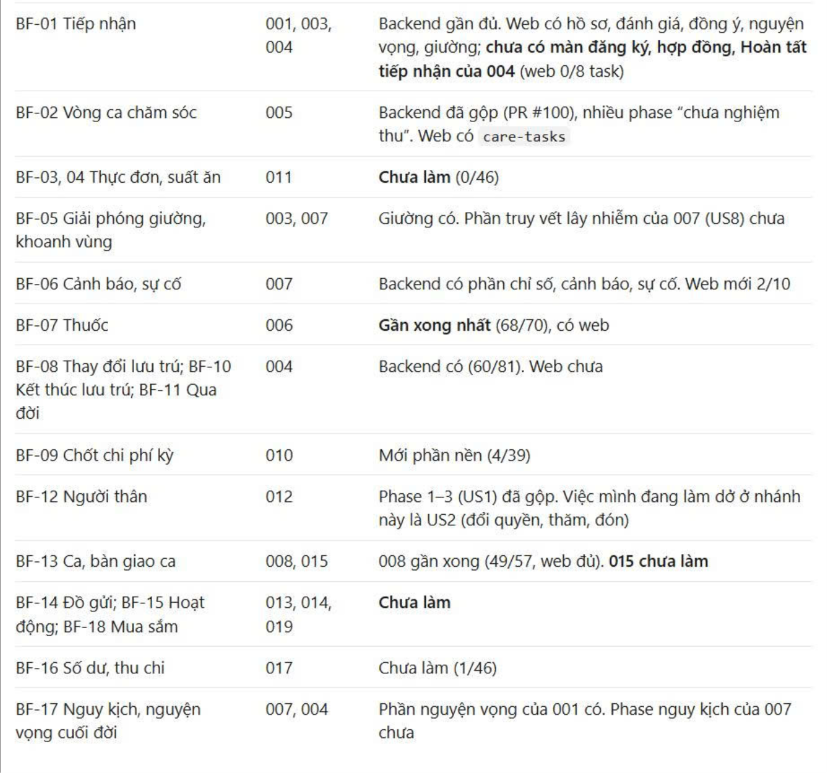

# Tích hợp phần đang dở của 008 — 04/11/2026

Nhánh `impl/008-integration`, worktree `.worktrees/008-integration`, nền `origin/develop` tại `62fdb4f2517aab104d073c309688c5dd2075a3da` (PR #106). Người dùng yêu cầu tiếp tục từ bản Q-262/R-15 đã có; không tạo lại các phần đã viết, không sửa API của A đang chờ.

## Phạm vi và bản sao giữ lại

- Snapshot nguồn `008-q262`: `.worktrees/.snapshots/008-integration-20261104/manifest.json`, `tree.txt`, `wip.patch`; 214 file hiện có được chép kèm SHA-256, 122 đường dẫn đã chuyển/xóa được ghi trong manifest. Snapshot tree `f202e8bd9bb103400a82693d041124f534df3225`; không tạo commit.
- Index tạm dùng để xuất đủ cả file mới. Index và 241 dòng status của worktree gốc không bị thay đổi. Đối chiếu SHA-256 sau ghép: 214/214 file nguồn giữ nguyên.
- Áp patch ba chiều lên nhánh mới, gỡ 11 file xung đột. Giữ lịch sử progress của develop và phần nguồn; giữ các thay đổi mới của thành viên khác, các API đã chuyển sang api.dto/api.events và bản sửa FR-057.
- Các worktree mobile, fixture, 010 và stash vẫn giữ riêng; lượt này chưa tích hợp mobile hoặc coi toàn feature 008 đã hoàn tất.

## Quyết định khi ghép

1. Giữ truy vấn người xác nhận FR-057 qua `AccountApi.byId`; phần R-15 đưa câu SQL lấy `confirmed_by` vào `HandoverStore.confirmedBy`. Test thông báo đổi mock từ JdbcTemplate sang Store và giữ assertion người nhận.
2. Giữ cấu trúc `staffing/internal/<chức năng>` và `staffing/web` của bản Q-262. Các test FR-057 và fixture báo cáo mới trên develop đổi import theo đường dẫn thực; không đổi endpoint, trường hoặc assertion nghiệp vụ.
3. `LayerArchTest` chỉ xóa ngoại lệ cấu trúc/JDBC của staffing; không khôi phục các ngoại lệ A/B/D đã được develop xử lý. `RecordGroupTriggerIT` giữ danh sách pending hiện hành của B/C, bỏ 25 bảng M09 đã được migration khai nhóm dữ liệu.
4. Giữ `T051` của develop cho FR-057. Sửa Q-262 dùng `T051a`; bước cấu trúc vẫn là `T050a`. Hai ô này đã đánh hoàn thành sau kiểm trên nền tích hợp. T050 vẫn mở.
5. Các bảng gộp, JSON bàn giao, định danh legacy, lịch sử/phạm vi, marker và UUID job giữ thiết kế R-15 đã được người dùng chốt trong các biên bản nguồn. Không tự bổ sung scanBefore vào phần A.

## Kết quả kiểm

Đã kết thúc bộ kiểm chọn và lượt hồi quy sau sửa fixture. Kết quả clean verify toàn backend và kiểm lại cuối ở mục dưới; T050 còn một test đỏ chờ API A, không gọi toàn verify hoặc toàn feature xanh.

- Hai lượt biên dịch đầu phát hiện import và constructor của test mới từ develop chưa theo cấu trúc R-15; đã sửa tham chiếu và mock, không thay assertion. Đây là lỗi ghép/biên dịch, không gọi là test nghiệp vụ đã chạy đỏ.
- Test đơn vị/kiến trúc chọn toàn bộ test đơn vị staffing, `*ArchTest` và `ModuleBoundaryTest`: 144/144 xanh ở lượt đầu.
- IT chọn toàn bộ 41 lớp staffing, `ApiContractIT`, `RecordGroupTriggerIT` và bốn lớp reporting dùng nguồn staffing: `FR_020_StaffingDashboardIT`, `FR_012_TimeScopeIT`, `FR_009_DetailMatchIT`, `SC_004_ScopeIT`. Tổng 318 IT/47 lớp: 316 xanh, một failure quét tỷ lệ mồ côi đã biết, một error fixture FR-057 mới còn ghi bảng cũ. Nhóm reporting 23/23, test nhóm dữ liệu và hợp đồng xanh sau khi chuyển fixture sang bảng đích.
- Sửa duy nhất INSERT của fixture FR-057 sang `staff_assignment.kind=FLOOR_MANAGER`, giữ nguyên assertion. Chạy lại `HandoverCorrectionNotificationsTest`, `HandoverNotificationsTest` và toàn bộ `HandoverIT`: 3 unit + 27 IT xanh, BUILD SUCCESS. Không cộng 27 vào 318; báo cáo mới nhất của 47 lớp hiện 317/318 xanh, một failure quét tỷ lệ mồ côi, 0 error/skip. XML của lượt đầy đủ được lưu riêng trước khi chạy lại.
- `DutyDirectoryIT` 7/7 xanh với quyền/phạm vi thật. `LayerArchTest` kiểm lại cuối 10/10 xanh và `spotless:check` qua; xóa hằng ngoại lệ staffing đã không còn được dùng, không tắt quy tắc kiến trúc.
- JVM test dùng đường dẫn ngắn của thư mục tạm người dùng cho `jdk.net.unixdomain.tmpdir` và `java.io.tmpdir`; chỉ áp cho lượt chạy, không đổi pom hoặc cấu hình máy. Nạp TEST_DB_* cùng DB_PASSWORD/DB_RETENTION_PASSWORD từ .env cục bộ, không chép thông tin đăng nhập vào kho mã.
- Lượt đầu dùng redirect qua PowerShell bị nghẽn output: thread dump có luồng giữ connection chờ Logback/Surefire ghi console, main chờ pool, MySQL không có khóa hàng chờ. Đã lưu dump/XML và dừng đúng JVM test 3280, không lấy lượt ngắt làm kết quả hoàn chỉnh. Lượt sau ghi trực tiếp bằng cmd và `-Dmaven.test.redirectTestOutputToFile=true`; lỗi chờ kết nối ở CredentialLifecycleIT không còn, 11/11 xanh, pool vẫn 5.
- Log ngoài target: `verify-008-direct.log` (bộ đầy đủ), `verify-handover-final.log`, `architecture-final.log`; XML đầy đủ ở `reports-direct`, lượt ngắt ở `reports-initial`, thread dump ở `thread-initial.txt`, cùng trong `.worktrees/.snapshots/008-integration-20261104`.

### Clean verify toàn backend và kiểm lại cuối

- Chạy `mvnw.cmd -q clean verify` không lọc lớp, không bỏ test; cùng tham số thư mục tạm ngắn và ghi output trực tiếp như trên. Kết quả: 1.071 test đơn vị/kiến trúc trong 217 suite xanh; 2.636 IT trong 481 suite có 1 failure, 2 error, 2 skipped; Maven exit 1. Số đơn vị/kiến trúc lấy từ XML: lớp `ProfileOpenGuardArchTest` có cả ArchUnit và JUnit nên tổng trong các file txt thấp hơn một.

| Điểm chưa qua trong lượt toàn bộ | Xử lý và kết quả kiểm lại |
| --- | --- |
| `StaffingRatioSchemaIT.FR_037_retentionFindsExpiredRatioEvenWhenDraftShiftHasBeenDeleted` | Vẫn đỏ do thiếu API `RecordEventApi.scanBefore` của A; giữ nguyên test, T050 mở. |
| `FR_024a_AllocationHandoverIT.FR_039_staffingSourceEndpointReadsTheRealAllocationProvider` | Fixture của 003 còn INSERT bảng `shift_template` đã gộp, bị từ chối INSERT. Chỉ đổi mẫu ca sang `catalog_item` loại `M09.SHIFT_TEMPLATE`, giữ thời gian, yêu cầu bàn giao và mọi assertion. Sau sửa cả 5 IT xanh; C review fixture. |
| `MissingConsentReminderIT.FR_012_remindsForTheFourOpenStatuses_notForAdmissionInProgress` | HikariPool-80 hết connection, timeout 30.338 ms, pool vẫn 5. Không sửa nguồn/test B hoặc cấu hình; chạy riêng lại toàn lớp 6/6 xanh. Chưa xác định nguyên nhân hoặc có bản sửa nên giữ B/A review, không gọi lỗi đã giải quyết hoặc mặc nhiên là baseline. |

- Hai skipped thuộc `SC_001_UrgentConcurrencyIT` của notification: có sẵn `@EnabledIfSystemProperty(eldercare.perf=true)`, chỉ chạy riêng trên schema `_perf` theo hướng dẫn của chủ module. Không thay điều kiện, không tính là test đã xanh. `ResidentContractIT` 1/1 xanh trong lượt này; không tiếp tục gọi lỗi hợp đồng cũ là lỗi đang tái hiện.
- Sau sửa fixture: `spotless:apply`, rồi `verify -Dtest=LayerArchTest -Dit.test=FR_024a_AllocationHandoverIT,MissingConsentReminderIT` với cùng tham số JVM/pool: 10 unit/arch và 11 IT xanh, Maven exit 0; Spotless kiểm qua. Không cộng các lần chạy hoặc dùng lượt chọn này để gọi `clean verify` toàn kho xanh.
- `reports-full/{surefire,failsafe}` giữ nguyên XML/txt của toàn bộ lượt trước khi kiểm lại; `reports-full/summary.json` ghi tổng. Log toàn bộ ở `clean-verify-full.log`, kiểm lại ở `verify-fixtures-final.log`, cùng thư mục snapshot nêu trên. Báo cáo kiểm lại được lưu riêng tại `reports-fixtures-final`.
- Rà fixture trên develop mới thấy thêm `ReportScopeFixture` và fixture 003; data-model 0.1 cập nhật danh sách 35 file, tasks T050 tham chiếu danh sách hiện hành. Đây là đổi bảng đích của fixture, không đổi nghiệp vụ/API.

### Thư mục tạm của JVM test trên Windows

Đã chọn hướng dẫn tham số cho từng lượt thay vì ghi đường dẫn máy vào pom. Từ backend, sau khi nạp đủ TEST_DB_* và hai mật khẩu tài khoản demo vào môi trường:

```powershell
$testTemp = (New-Object -ComObject Scripting.FileSystemObject).GetFolder($env:TEMP).ShortPath
.\mvnw.cmd verify "-Dtest=LayerArchTest,HandoverCorrectionNotificationsTest,HandoverNotificationsTest" "-Dit.test=DutyDirectoryIT,HandoverIT" "-DargLine=-Djdk.net.unixdomain.tmpdir=$testTemp -Djava.io.tmpdir=$testTemp" "-Dmaven.test.redirectTestOutputToFile=true"
```

`StaffImportTransportIT` cũng xanh trong bộ đầy đủ với cùng tham số thư mục tạm ngắn. Không sửa cấu hình máy hoặc dùng kết quả này để bỏ test môi trường ở các lượt khác.

## Kiểm môi trường (chỉ đọc)

- Hai migration mới của lượt tích hợp là `V008_94` và `V008_95`; không áp vào schema dev trong phiên này. Không có `DB_URL` trong môi trường hoặc hai file `.env` đang dùng; schema mặc định `elder_care` của application.yml không tồn tại trên MySQL test cục bộ. Vì vậy chưa xác nhận được migration cao nhất đã chạy trên schema dev thực tế của E.
- Khi có schema dev, đối chiếu `flyway_schema_history` với migration mới. Nếu có số nhỏ đến sau, theo dòng “Ghi nhớ migration số nhỏ” của team-plan mục 8: chạy một lần với `spring.flyway.out-of-order=true` hoặc dựng lại schema dev; schema test tự dựng lại trong mỗi JVM.
- Lượt tích hợp không đổi `pom.xml`, `package.json` hoặc `pubspec.yaml`; không có lệnh cài dependency mới cho phần này. Không sửa cấu hình máy hoặc mật khẩu.

## Phụ thuộc và review

- A/000: cung cấp `RecordEventApi.scanBefore(kind, cutoff, afterId, limit)` cùng bản thật/fake/test theo `shared-event-scan-proposal.md`; T050 chưa được đóng khi chưa tìm được lịch sử tỷ lệ của ca Nháp đã xóa.
- A review V008_94, thay đổi danh sách pending trong test chung và fixture reporting chuyển bảng đích; C review fixture mẫu ca của `FR_024a_AllocationHandoverIT`. Bản cài module A/C không thay đổi; test giữ các tình huống/quyền/số liệu đã có.
- B/001 và A/000,009 rà error pool mới ghi nhận trong lượt toàn kho của `MissingConsentReminderIT`; chạy riêng xanh chưa phải bản sửa.
- A/002, C/014 review consumer Q-262; C/D còn nguồn thật và nghiệm thu T043b/T049b.
- Không commit/push/mở PR trong phiên này; code được chuẩn bị để người dùng xem và chốt Git sau kết quả kiểm.
